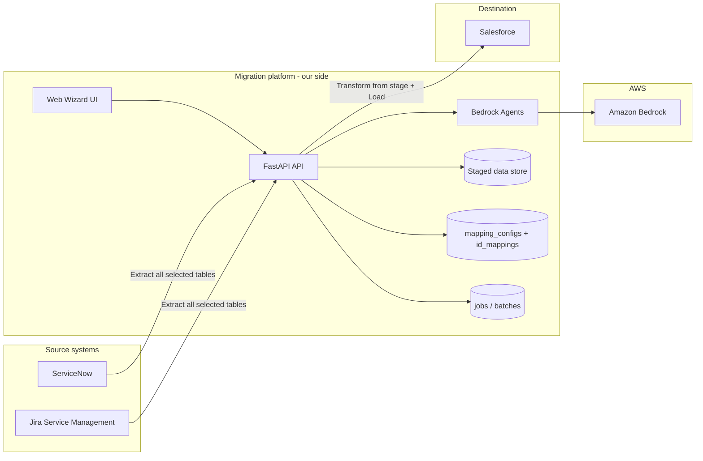
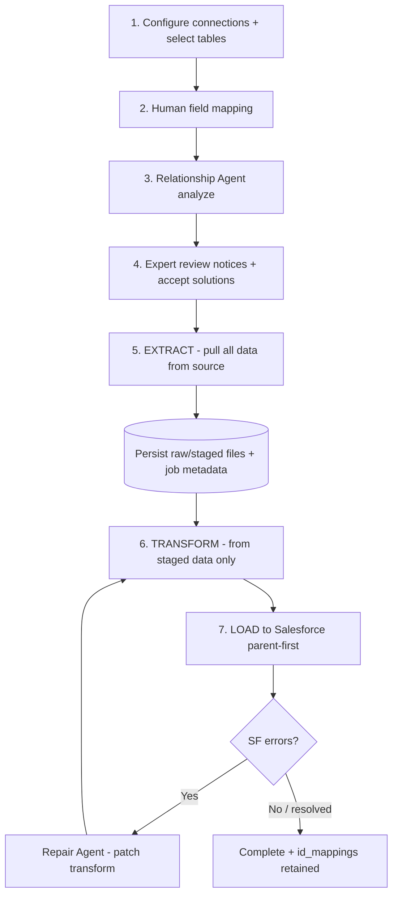
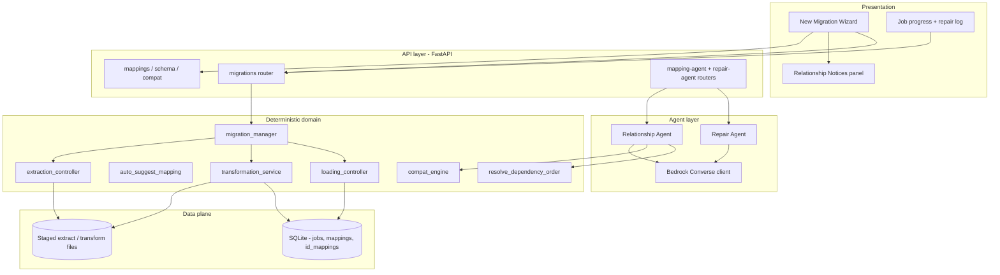
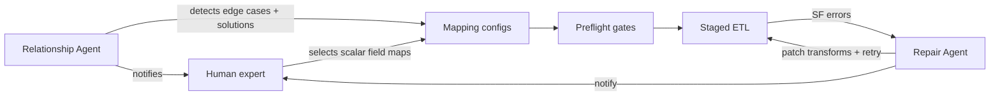
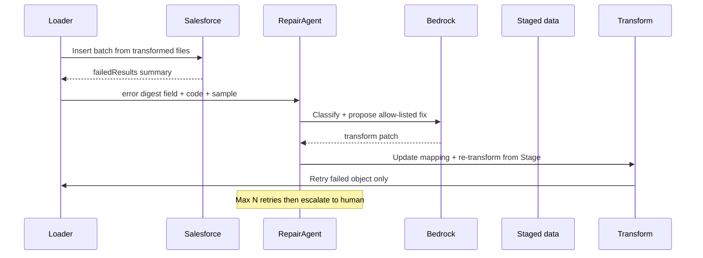
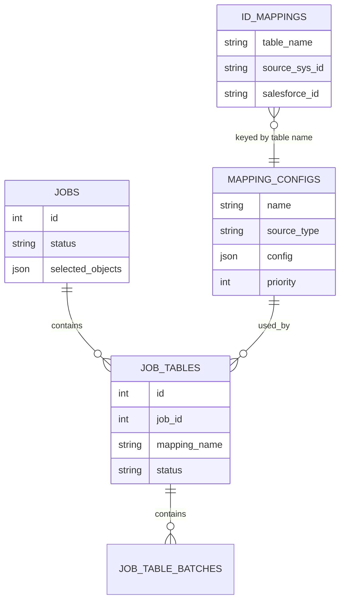
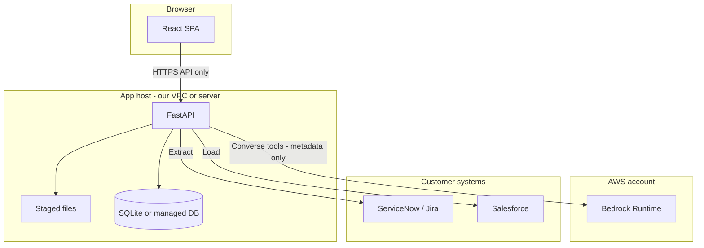

# ITSM Migration Platform — System Architecture

**Audience:** Technical director  
**Purpose:** Full architecture for staged ServiceNow/Jira → Salesforce migration with Bedrock agents  
**Data strategy:** Fetch **all** selected source data and persist it **on our side** first; transform and load run against our staged store — **not** on-the-fly streaming from source to Salesforce.

---

## 1. Goals

1. Human experts own **field mapping** (which source fields → which Salesforce fields).  
2. Agents own **relationship edge cases** and **load-error repair** (detect, notify, propose/apply solutions).  
3. Migration is **staged**: Extract → Our storage → Transform → Load.  
4. Runtime remaps (sys_id → Salesforce Id) stay **deterministic**; agents configure and guard them.

---

## 2. High-level system context



---

## 3. Staged data pipeline (core design)

**Principle:** Never migrate “on the fly” (row from ServiceNow straight into Salesforce). Always land a full extract locally first.



### Why staged (not on-the-fly)

| Concern | Staged approach |
|---------|-----------------|
| Replay / retry | Re-transform + reload without re-hitting source |
| Audit | Exact payload that was migrated is retained |
| Agent repair | Repair Agent rewrites transforms against local stage |
| Source load | One extract window; less long-lived source API pressure |
| Consistency | Snapshot of related tables extracted together |

### Staging layout (logical)

```text
data/
  downloads/          # raw extracts per job / table
  transformations/    # transformed payloads ready for SF
  database/           # SQLite: jobs, batches, mapping_configs, id_mappings
```

Extract writes into `downloads/`; transform reads only from staged extracts; load reads transformed output. Agents never call Salesforce insert APIs directly — only through the existing loader.

---

## 4. Component architecture



---

## 5. Agent architecture

### 5.1 What humans vs agents own



| Owner | Responsibility |
|-------|----------------|
| Human | Field-to-field mapping choices |
| Relationship Agent | Scan object graph; identify edge cases; notify; propose concrete fixes (lookup, parents, order, block raw Id) |
| Deterministic ETL | Extract to stage, transform, load, store `id_mappings` |
| Repair Agent | Interpret SF errors; allow-listed transform fixes; retry from stage |

### 5.2 Relationship Agent — edge-case catalog

The agent does **not** assume only “parent then child.” It classifies and solves:

1. Parent → child Id remap (new SF Ids)  
2. Multi-level chains (Company → Dept → User → Incident)  
3. Multiple FKs on one child  
4. Missing parent in migration set  
5. Junction / M2M (two parents before junction)  
6. Self-reference / cycles  
7. Constant FK vs migrated parent  
8. Attachments linked to parent  
9. Upsert / pre-existing destination records  
10. Raw sys_id on SF reference (block)  
11. Wrong `id_mappings` lookup table name  

**Output:** Relationship Notices + proposed mapping patches + dependency order.

### 5.3 Repair Agent — runtime loop



---

## 6. End-to-end runtime sequence (staged)

```mermaid
sequenceDiagram
  participant U as Expert
  participant UI as Wizard
  participant API as API
  participant RA as RelationshipAgent
  participant Stage as Stage store
  participant Src as Source system
  participant MM as MigrationManager
  subgraph etl [ETL]
    Ex as Extract
    Tr as Transform
    Ld as Load
  end
  participant SF as Salesforce

  U->>UI: Map fields
  UI->>API: analyze-relationships
  API->>RA: configs + schemas
  RA-->>UI: notices + solutions
  U->>UI: Accept solutions / launch
  UI->>API: create migration job
  API->>MM: start job
  MM->>Ex: extract all selected tables
  Ex->>Src: query tables
  Ex->>Stage: persist full extracts
  loop Parent-first groups
    MM->>Tr: transform from Stage
    Tr->>Stage: write transformed files
    MM->>Ld: load to SF
    Ld->>SF: insert
    Ld->>API: write id_mappings
  end
```

---

## 7. Data model (our side)



**Id remap at load time (deterministic):**

```text
Load ObjectSFA → insert rows → for each success:
  id_mappings[source_sys_id] = new_salesforce_id

Transform ObjectSFB FK field:
  generic_lookup(source_sys_id) → salesforce_id from id_mappings
```

---

## 8. Deployment / trust boundaries



**Security rules**

- Credentials never sent to Bedrock  
- Bedrock receives schema metadata, mapping drafts, error digests — not full extract dumps  
- Agents have no direct SF write tools  
- Staged data stays on our side under job isolation  

---

## 9. Technology map

| Layer | Technology |
|-------|------------|
| UI | React (wizard, notices, progress) |
| API | FastAPI |
| Agents | Amazon Bedrock Converse + tool use (Claude) |
| Extract / Transform / Load | Existing controllers + `migration_manager` |
| Stage | Local/files + DB (`data/downloads`, `data/transformations`) |
| Mapping / Id maps | SQLite `mapping_configs`, `id_mappings` |
| Compatibility / order | `compat_engine` |

---

## 10. API surface (agent + migration)

| Endpoint / hook | Role |
|-----------------|------|
| `POST /api/mapping-agent/analyze-relationships` | Notices + proposed solutions |
| `POST /api/mapping-agent/plan` | Optional fuller plan |
| Preflight in `migration_manager` | Block raw references / missing parents |
| `POST /api/migrations/` | Start staged job |
| Extract phase | Persist all tables to stage |
| Post-load failure hook | Repair Agent |
| `POST /api/mapping-agent/repair` | Apply patch + retry object from stage |

---

## 11. Phased delivery

| Phase | Deliverable |
|-------|-------------|
| 0 | Bedrock access + IAM |
| 1 | Relationship Agent: detect + notify + propose solutions |
| 2 | Wire solutions into mappings + preflight; confirm staged extract path |
| 3 | Repair Agent: error → patch → re-transform from stage → retry |
| 4 | Pilot on real schema + metrics |

---

## 12. Director summary (one slide)

```text
Expert maps fields
        ↓
Relationship Agent finds relationship edge cases + proposes fixes
        ↓
EXTRACT everything → OUR STAGE
        ↓
TRANSFORM (lookups use id_mappings) → LOAD to Salesforce (parents first)
        ↓
On SF datatype errors → Repair Agent fixes transform → retry from stage
```

**Ask:** Bedrock Converse access for Relationship + Repair agents.  
**Non-ask:** Agents do not replace human field mapping; agents do not write to Salesforce outside existing loaders.

---

## 13. How to use this document

- Open in Cursor / VS Code / GitHub to render Mermaid diagrams  
- Export to PDF via Markdown preview print, or paste diagrams into PowerPoint  
- For a slide deck: sections 2, 3, 5, 6, 8, 12 are the core visual story
