# ITSM Migration Platform — System Architecture

**Audience:** Technical director / engineers joining the codebase
**Purpose:** Reference architecture for the staged ServiceNow / Jira Service Management → Salesforce migration platform and the Bedrock agent layer on top of it
**Data strategy:** Fetch **all** selected source data and persist it **on our side** first; transform and load run against our staged store — **not** on-the-fly streaming from source to Salesforce.

> This document describes the system as it is implemented. `docs/architecture.html` is the narrative version of the same material for a non-engineering audience, and is the source for the PDF and Word exports.

---

## 1. Design rules

1. **Only the ETL moves record data.** Agents read schema metadata, mapping drafts, dependency graphs and load-error text. They never call Salesforce write APIs and never modify staged files. The one exception to "no record data" is post-load diagnosis: the diagnosis and assistant agents may read a capped, truncated sample of the rows Salesforce rejected and a profile of one staged source column, because an error like *"Resolution Date must be after Start Date"* cannot be explained from schema alone. `AGENT_DIGEST_SAMPLES=0` turns the row values off (section 5.8).
2. **Humans own field-to-field mapping.** Deciding that a source field belongs in a particular Salesforce field stays a human decision, supported by a model-assisted pass that proposes pairs and never writes one.
3. **Agents own relationship correctness and load-error repair.** Identifier remapping, id-map wiring, parent ordering, cycles, missing parents, and post-load failures. The agent wires the fix rather than reporting a to-do.
4. **Every agent write is bounded, validated and reversible.** Resolutions are drawn from a fixed vocabulary, validated against a live Salesforce describe and a transform allow-list, journalled with the value they replaced, and revertible one item at a time.
5. **What repair cannot fix, a person approves.** Automatic repair stops at the failures it has a safe answer for. Anything left is diagnosed and offered as a *proposal*; nothing is written until someone clicks Apply, and Apply is deterministic — it never calls the model.
6. **The pipeline degrades to deterministic behaviour.** If Bedrock is unreachable the agent pass is skipped and the run proceeds. No model call sits on a data-integrity critical path — ordering, id resolution and the launch gate are all deterministic code.
7. **Runs are resumable.** Session state is checkpointed to S3 at every phase boundary, so an interrupted migration continues from what was already written instead of restarting.

---

## 2. High-level system context

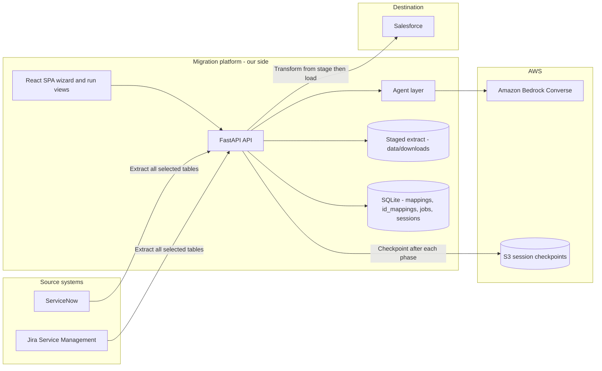

---

## 3. Staged data pipeline

**Principle:** never migrate on the fly. A full extract lands locally before any transform runs.

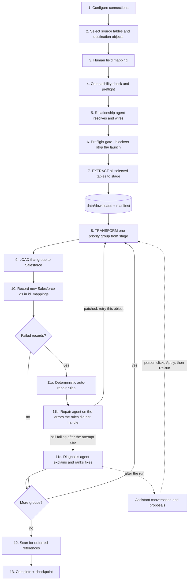

Step 11 is now three layers, cheapest first. Deterministic rules fix the error classes that have exactly one correct answer without a model call. The repair agent takes whatever the rules did not recognise. Whatever is still failing after `AGENT_REPAIR_MAX_ATTEMPTS` is handed to the diagnosis agent, which writes nothing: it explains the cause and attaches validated fixes that a person can turn into a proposal. All three are gated by `AGENT_REPAIR_ENABLED` (or the per-run `agent_repair` option), and diagnosis can additionally be switched off per run with `agent_diagnosis: false`.

### Why staged rather than streaming

| Concern | Staged approach |
|---------|-----------------|
| Replay / retry | Re-transform and reload without re-hitting the source |
| Audit | The exact payload that was migrated is retained on disk |
| Agent repair | The repair agent re-transforms one object from local data |
| Source load | One extract window instead of long-lived API pressure |
| Consistency | Related tables are extracted in one snapshot |
| Resume | A checkpoint plus a stage fingerprint decides whether extraction can be skipped |

### Storage layout

```text
data/
  downloads/{source_type}/{source_table}/{batch_size}_{batch_no}.csv   # the staging boundary
  staging/job_{job_id}_manifest.json                                   # extract manifest + verification
  transformations/csv/{name}/{batch}/...                               # transform output
  transformations/csv/{name}/{batch}/deferred.csv                      # rows whose lookup resolved empty
  transformations/hash/{name}/...                                      # dedupe hashes
  results/{name}/{job_table_id}/{batch}/{priority}_{operation}/        # success / failed / unprocessed CSVs, one folder per load attempt
  database/db/data.db                                                  # SQLite
  database/sql/schema/001..011_*.sql                                   # DDL
```

Every load attempt writes its results under its own `job_table_id` folder, so a repaired retry does not overwrite the attempt it is retrying. Anything that asks "what is failing now" — the error digest and the `sample_failed_rows` tool — reads only the newest folder, through `error_digest.latest_job_dir()`; earlier folders hold rows that have since loaded.

`staging_service.verify()` raises `StagingIncomplete` if a driving table has no staged rows, so a partial extract cannot silently produce a partial load. `workspace_service.clean_working_state()` clears downloads and transform output for the selected mappings on a fresh run; `clean_transformed_state()` clears only transform output when extraction is being skipped on a resume.

---

## 4. Component architecture

```mermaid
flowchart TB
  subgraph presentation [React SPA]
    Wizard[New Migration Wizard - 6 steps]
    Detail[Migration detail - live progress]
    Notices[AgentNoticesPanel]
    Assist[AgentAssistantPanel]
    Resol[ResolutionsPanel]
    Backfill[BackfillPanel]
    Fill[ColumnFillPanel + ColumnFillDrawer]
    Objects[SessionObjectsPanel]
    Status[SessionStatusPanel]
    Hier[DestinationHierarchy + ObjectFieldsDrawer]
  end

  subgraph api_layer [FastAPI routers]
    R1[migrations]
    R2[mappings / schema / compat / transforms]
    R3[mapping-agent]
    R4[connections / sources]
  end

  subgraph agents [Agent layer]
    Ctx[context]
    Det[detector]
    Rel[relationship_agent]
    AR[auto_repair]
    Rep[repair_agent]
    Diag[diagnosis_agent]
    Asst[assistant_agent]
    AStore[assistant_store]
    Tools[tools - dispatcher]
    Res[resolutions validator]
    Wire[wiring]
    Pre[preflight]
    Aud[audit]
    Sum[summary]
    FM[field_matcher]
    OA[order_advisor]
    BC[bedrock_client]
  end

  subgraph domain [Deterministic domain]
    MM[migration_manager]
    Compat[compat_engine]
    Hier2[hierarchy_service]
    Prereq[prerequisites_service]
    Stg[staging_service]
    Xf[transformation_service]
    Ld[loading_controller]
    BF[backfill_service]
    CF[column_fill_service]
    CP[checkpoint_service]
    SS[session_status_service]
  end

  subgraph data [Data plane]
    Files[(Staged and transformed files)]
    DB[(SQLite)]
    S3[(S3 checkpoints)]
  end

  Wizard --> R2
  Wizard --> R3
  Detail --> R1
  Notices --> R3
  Assist --> R3
  Assist -->|Re-run| R1
  Resol --> R3
  Backfill --> R1
  Fill --> R1
  Objects --> R1
  Status --> R1
  Hier --> R2

  R1 --> MM
  R1 --> CF
  R3 --> Rel
  R3 --> Rep
  R3 --> Diag
  R3 --> Asst
  R3 --> Pre
  R3 --> OA
  R2 --> FM
  R2 --> Hier2

  Rel --> Ctx
  Rel --> Det
  Rel --> Res
  Res --> Wire
  Wire --> Aud
  Rel --> Sum
  Rel --> BC
  Rep --> AR
  AR --> Wire
  Rep --> BC
  Diag --> Tools
  Diag --> Res
  Diag --> AStore
  Asst --> Tools
  Asst --> Res
  Asst --> AStore
  Asst -->|on Apply| Wire
  Diag --> BC
  Asst --> BC
  Tools --> Files
  Pre --> Det
  Ctx --> Compat

  MM --> Pre
  MM --> Rel
  MM --> Stg
  MM --> Xf
  MM --> Ld
  MM --> Rep
  MM --> Diag
  MM --> BF
  MM --> CP
  CF --> Xf
  CF --> Ld
  Xf --> Files
  Ld --> DB
  AStore --> DB
  CP --> S3
  SS --> DB
```

---

## 5. Agent layer

### 5.1 Who owns what

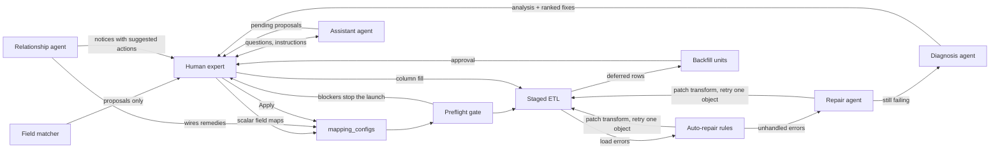

| Owner | Responsibility |
|-------|----------------|
| Human | Field-to-field mapping choices; approving backfill passes; deciding blockers; applying or rejecting assistant proposals; requesting column fills |
| Field matcher (`agents/field_matcher.py`) | The only suggester: proposes pairings for every unmapped field, whether the two names agree or only the meaning does, each scored by semantic similarity. Proposals only — never writes a config |
| Value matcher (`agents/value_matcher.py`) | Proposes the value map inside a mapped picklist field, checked against the record type's values and the controlling picklist. Proposals only |
| Detector (`agents/detector.py`) | Deterministic scan for known relationship and datatype edge cases |
| Relationship agent (`agents/relationship_agent.py`) | Decides a remedy per finding, reports anything the detector did not recognise, writes the resolution and the load order |
| Preflight (`agents/preflight.py`) | Deterministic launch gate; no model involved |
| Deterministic ETL | Extract to stage, transform, load, record `id_mappings` |
| Auto-repair (`agents/auto_repair.py`) | Deterministic rules for load errors that have exactly one correct fix; runs before the repair agent's model call, no model involved |
| Repair agent (`agents/repair_agent.py`) | Interprets the Salesforce load errors auto-repair did not handle, patches the offending field transform, signals a retry |
| Diagnosis agent (`agents/diagnosis_agent.py`) | Explains the rows still rejected after repair, with evidence and ranked fixes. Writes no mapping — its validated fixes can be turned into proposals |
| Assistant agent (`agents/assistant_agent.py`) | Per-session conversation about failures. Investigates with the diagnosis tools and stores proposals; never applies one |
| Order advisor (`agents/order_advisor.py`) | Advisory migration-order narrative for the hierarchy view; never replaces the loader's order |

### 5.2 Deterministic detection — the finding vocabulary

`agents/detector.py` runs first, before any model call, and produces findings over the selected mappings. Blocking findings are what the preflight gate refuses to launch on.

| Finding | What it detects | Blocking |
|---------|-----------------|----------|
| `raw_reference` | A lookup field copies a raw source id with no resolution step | **yes** |
| `raw_id_in_text` | A destination **text** field copies a source column that is a pointer, so the id is stored as unusable text | no |
| `unmapped_required_reference` | A required lookup has no mapping although a parent in the run loads the referenced object | **yes** |
| `missing_parent` | A required lookup has no value source and no parent mapping in the run | **yes** |
| `lookup_table_mismatch` | `generic_lookup` resolves against an id-mapping table other than the one this run's parent writes | **yes** |
| `unresolvable_lookup` | `generic_lookup` has no id source at all: the table it names is empty and no selected mapping fills it | when the field skips unattached rows, or is required |
| `transform_missing` | The named `transformation_function` does not exist for this mapping's source type | **yes** |
| `lookup_wired` | A lookup is already wired to the correct id-mapping table | no (info) |
| `constant_over_migrated_parent` | A lookup is pinned to a constant while a parent mapping migrates that object | no |
| `self_reference` | A lookup points back at the same destination object | no |
| `deferrable_cycle` | A lookup targets an object that references back, is **not** in this run, but does have a mapping in the catalog | no |
| `dependency_cycle` | Selected mappings form a reference cycle, so no parent-first order exists | no |
| `junction_object` | A mapping links two or more migrated parents and must load after both | no |
| `attachment_parent_link` | An attachment table whose parent link must resolve to a migrated parent id | no |
| `unverified_transform` | A lookup resolved through a bespoke transform the detector cannot verify | no |
| `type_mismatch` | Source and destination types are incompatible with no transform in between | no |
| `picklist_unmapped` | A picklist value the destination will not accept — see 5.2.1 | when the picklist is restricted |
| `no_external_id` | An insert operation with no `external_id_field`, so a re-run would duplicate | no |
| `schema_unavailable` | The destination describe failed, so relationships cannot be verified | no |

`raw_id_in_text` is the one check in the table that does not start from the destination, and it exists because every check that does was blind to it. The others ask Salesforce "is this field a reference?" and act on the answer. A custom field created as `Text(255)` answers no — legitimately, since a text field may hold anything — so a column named `Reportedbyid__c` fed from a ServiceNow reference column produced no finding, no warning in the field mapper, and no **Lookup** option in its value-source dropdown. The mapping looked complete and the load reported success.

It is the quietest failure in the vocabulary, and quiet in proportion to the damage. A real lookup rejects a source id with `MALFORMED_ID`, so the row fails visibly and gets fixed. A 255-character text column accepts a 32-character `sys_id`, and the result is a value that cannot be followed, filtered or reported on, and that nothing keeps in step with the record it names. The only side that knows the value is a pointer is the *source*, so this check reads the source schema — ServiceNow marks such columns `type: reference` with a `reference_table` — rather than the destination. `sys_id` itself is typed `GUID`, not `reference`, so an external-id column is not caught by accident; it is exempted explicitly as well, since holding the source id is its purpose.

It is deliberately not blocking, and not in the relationship agent's `decidable` set. The load does succeed, and keeping a source id as an intentional traceability column is a real choice — but it is a choice, and previously nobody was told they had made it. The remedy names what the pointed-at table becomes if anything migrates it, so the finding can say *"`sys_user` is migrated to `Account` (796 ids), so there is a real id this could hold"* rather than only that something is wrong. Fixing it properly means changing the field's type in the destination org, which no mapping change can do, which is why the agent is not asked to resolve it.

`transform_missing` and `deferrable_cycle` were added after the original design. The first exists because a mapping could name a transform belonging to a different source type — a JSM helper on a ServiceNow mapping — and the failure only surfaced mid-transform. It is now caught at preflight, and `/api/transforms/` filters the picker by `source_type` so the invalid choice cannot be made in the first place. The second is covered in section 6.

`unresolvable_lookup` closes a gap between two of the checks above, and it is worth stating plainly because the gap cost a silent loss of every row in a table. `missing_parent` only inspects *required* lookups, on the reasoning that an optional one merely loads empty. `lookup_table_mismatch` compares the configured table against the one a selected parent writes — which needs a selected parent to compare against. When nothing in the run loads the referenced object there is no parent, so the comparison had nothing to disagree with and the field was reported as `lookup_wired`: correctly wired. An optional lookup onto an object nobody migrates therefore passed both checks and was described as healthy.

It is the more damaging case, not the milder one. A mismatch resolves to empty; this resolves to empty *and*, where the field carries `skip_if_not_found`, discards the record during transformation. A table can then extract fully, transform to nothing, and report no failures — which is exactly what "100 fetched, 0 processed, 0 failed" was.

Two details keep it from crying wolf, since a gate that does gets switched off. Resolvability is judged against the id-mapping tables that *actually hold ids*, not just those this run will write, because a parent migrated in an earlier session or a table maintained by a sync resolves perfectly well. And a field already deferred to backfill is left alone when its parent can still be loaded, because being empty for now is the point of deferring — unless nothing can ever load that parent, in which case the deferral never completes and is raised.

The remedy it proposes depends on whether any mapping in the catalog loads the referenced object. Where one does, adding it to the run or deferring the field are both offered. Where none does — a lookup onto `User`, say, which is provisioned rather than migrated — advising "include a mapping for it" would be advice that cannot be taken, so the finding instead offers pinning the field to a fixed record, retargeting it at an object the run does load, or leaving it unmapped.

#### 5.2.1 Picklist governance

A Salesforce picklist is governed by three things the object describe does not make obvious, and each one produced a class of failure that only appeared at load time.

**Restriction.** A restricted picklist rejects the row when handed a value outside its list. An unrestricted one accepts the value and stores it off-list, which succeeds and quietly fills a column with entries no report or filter will match. The two need different handling, so `restrictedPicklist` is carried through as `picklist_restricted` and decides whether `picklist_unmapped` blocks the launch or merely warns.

**Record type.** The describe returns the union of values across every record type. What a load may actually write is whatever the record type on the record offers, which can be a strict subset even on an object with a single record type. On the `Incident` object in a customised org this is not a marginal difference — `ReportedMethod` describes four values and offers two. `get_destination_fields` therefore takes an optional `record_type_id`, read off the mapping's own `RecordTypeId` constant by `record_type_id_of`, and narrows `picklist_values` to the values that record type serves. The difference is reported in `picklist_unavailable` rather than dropped, because a value that exists on the field and is still refused is exactly the case where an accurate message matters: it looks correct in every describe.

**Dependency.** A dependent picklist is judged against its controlling field, so a child value can be valid in isolation and rejected in context. The scoped fetch returns each value's `validFor` bitmap, which is inverted into `picklist_valid_for` — controller value to the entries it permits. That is enough to settle the pairing before extraction: if a mapping sets a child but never sets the controller, or maps the child to something no controller value it produces permits, preflight says so.

The scoped values come from `/ui-api/object-info/{object}/picklist-values/{recordTypeId}`, whose payload is HTML-escaped, so values are unescaped on the way in — otherwise `Access & Accounts` arrives as `Access &amp; Accounts` and compares unequal to the value the loader sends. A failure of that endpoint degrades to the describe rather than failing the run: it is a refinement, and losing it should narrow what can be checked, not stop the migration.

All of this reaches the same four consumers through one function. The compatibility report warns on it in the wizard, the detector raises it at preflight, the value matcher below proposes against it, and `agents/resolutions.py` refuses to wire a value map that targets an unavailable or dependency-invalid value — so the model cannot propose a fix that was only ever going to fail. Because the record type changes the answer, it is part of the cache identity in both `MigrationContext` and `services/internal/schema_cache.py`.

#### 5.2.2 Value matching

Governing a picklist correctly still leaves the mapping itself to author, one value at a time. Nothing in the two vocabularies lines up: a ServiceNow incident state is a numeric code with a label, and the Salesforce picklist it feeds was named by whoever configured the org, so across the `Incident` picklists in a customised org the literal overlap is nil. Comparing strings finds nothing there, and the substring fallback it invites is actively wrong — it pairs `Closed` with `Closed Incomplete` and changes what a record means.

So `agents/value_matcher.py` does for values what `agents/field_matcher.py` does for fields. It shows the model the distinct values in the source column and the values the picklist will accept, and asks for a pairing with a rationale and a confidence on each. Two things differ from field matching:

- **Many to one is the normal shape.** `Closed Complete` and `Closed Incomplete` both belong on `Closed`, so the destination side is deliberately not held to one use each. Only the source side is: a value with two homes is a contradiction, a value shared by two sources is a mapping.
- **The check is the scoped one.** A proposal is refused unless the value is offered by *this mapping's* record type and permitted by the controlling picklist given what the controller's own mapping produces — both read off the draft on screen rather than asked for. A value that is spelled correctly and still unreachable is refused with the controller named, because that is the case where a vague message costs the most.
- **The bias is reversed.** Field matching prefers an unmapped field to a speculative pair, because an unmapped field costs one decision and a wrong one corrupts a column. Values have no equivalent safe default: a source value with no destination rejects the whole record on a restricted picklist and is written through unrecognised on an unrestricted one, so declining to choose is itself a decision with consequences. The model is therefore asked to find every value its closest available home — the catch-all where nothing specific fits — and confidence becomes the signal for which pairings are approximations rather than a bar they must clear. Anything under the threshold is applied and flagged, so an approximation is visible rather than absent. Two rules still outrank this: an ordered scale must keep its direction, and a terminal state must not become an active one.

Only where the picklist offers no plausible home at all does a value come back unmapped, and the model says what kind of value would have been needed. Nothing is written to a mapping config — the result is a draft in the value-map editor, which marks the approximate rows, lists their reasoning, and keeps a free exact-match pass for the values that genuinely do agree.

#### 5.2.3 Idempotent re-runs

`no_external_id` is the one finding whose remedy the pipeline cannot write on its own. A load that partly succeeds leaves the destination holding records the source cannot point back to, because a Salesforce id lives only in the local `id_mappings` table; lose or reset that table and a second attempt has no way to tell a record it created from one it has never seen, so it inserts the successful rows again. Rows are matched on a content hash as a fallback, but a hash changes the moment a mapping is edited, which is exactly what happens between a failed attempt and the retry.

The fix is a field in the destination holding the source's own key. When a mapping declares `external_id_field`, `controllers/loading_controller.load_batch` issues the Bulk API job as an `upsert` on that field instead of an `insert`, so the first run inserts and every run after it matches and updates. Salesforce will only accept an upsert key that is indexed, which means the field must be created with both the `externalId` and `unique` flags — `POST /api/custom-fields/create` takes them, and the mapping editor offers the option for the three types Salesforce permits it on (Text, Number, Email).

Two conditions are easy to miss and both fail the whole job rather than one row. The field has to be visible to the profile the integration authenticates as, since a newly created custom field is not automatically readable by non-admin profiles — the describe's `idLookup` and `createable` flags are the check. And the field has to be *mapped* from the source key, because an external id the transform leaves blank is not a key at all. Records loaded before the field existed carry no value, so they cannot be matched retrospectively; they are either deleted or accepted as orphans.

### 5.3 The bounded remedy set

Detection is open-ended; action is not. Whatever the model concludes, the fix it applies must be one of these, and each one is ordinary pipeline configuration an engineer would otherwise hand-author. `agents/resolutions.py` rejects anything else before `agents/wiring.py` ever sees it.

| Resolution kind | What gets written into the mapping config |
|-----------------|-------------------------------------------|
| `lookup_reference` | `generic_lookup` on the field, with `lookup_tables` derived from the parent mappings' id-mapping tables |
| `constant_reference` | A fixed `constant_value`, transform and source field cleared |
| `type_coercion` | An allow-listed `transformation_function` plus its parameters |
| `value_map` | `generic_value_map` built from the destination's own allowed values |
| `external_id_upsert` | A mapping-level `external_id_field` so a re-run upserts instead of duplicating |
| `self_reference_guard` | `generic_lookup` against the mapping's own id-mapping table |
| `deferred_lookup` | `generic_lookup` with `defer_to_backfill`, a `defer_reason` and the `defer_parents` it is waiting on |
| `remove_field` | Removes the field entry from the mapping, so the destination field is no longer written. The removed entry is journalled whole, so revert restores it |
| `notice` | **Writes nothing.** Advisory only, and must carry a `suggested_action`, which is stored in the journal's `new_value` and read back as `suggested_action` |
| `load_order` | Writes the deterministic parent-first order onto each mapping's `priority` |

Three things are worth calling out. `load_order` is written by the agent but *computed* by `compat_engine.resolve_dependency_order()` — the model never chooses a sequence. `notice` is a first-class outcome: refusing to guess is treated as a valid conclusion rather than a failure to resolve. And `remove_field` is validated *before* the destination describe is consulted, on purpose: a field the destination no longer has is one of the main reasons to unmap it.

`type_coercion` and `value_map` may set any transform in the allow-list, which is exactly `services/transforms/generic.GENERIC_TRANSFORMS`: `generic_default_if_empty`, `generic_truncate`, `generic_value_map`, `generic_format_datetime`, `generic_concat`, `generic_strip_html`, `generic_length_guard`, `generic_lookup` and `generic_rules`. Two of these carry most post-load fixes:

- **`generic_rules`** chooses a value by testing ordered conditions against named source columns (`equals`, `in`, `is_empty`, `gt`, `matches` and so on); the first matching rule wins and `otherwise` decides the rest. The runtime hands transforms positional values, so `params.inputs` must list the columns in the same order as the field's comma-separated `source_field`. The column-fill preview uses the same function through `rules_trace()`, so the preview and the write can never disagree.
- **`generic_length_guard`** enforces a minimum and maximum length. It pads repeatedly to the minimum (with a built-in filler when `pad_with` is not set), fills from `default` when every source value is empty, joins extra source fields with `context_separator`, and truncates with `truncation_suffix`. Two details exist because of real rejections. `limit_margin` stays inside both limits, for validation rules written as `LEN(x) < 1000` that reject the boundary their message names. And the maximum is reduced by the number of newlines, because the Bulk API sends CRLF and Salesforce counts each `\n` as two characters.

Every generic transform now takes its values as `*values`, so any of them can be fed from more than one source field.

### 5.4 Notices, review-always, and wiring summaries

Three changes since the original design, all driven by the same requirement: the operator should never be surprised by something the agent did or by something it noticed and could not fix.

**The model is asked to review even when the detector found nothing.** The deterministic checks only cover edge cases somebody wrote a rule for, so a run with zero findings used to skip the model entirely and an unanticipated relationship shape went unreported. With `AGENT_REVIEW_ALWAYS=true` (the default) the model is invoked anyway, with a prompt that states the findings are not exhaustive and asks it to raise anything it recognises as a problem. A review-only call that fails is logged and the run continues to load ordering.

**A notice must say what to do about it.** `agents/resolutions.py` rejects a `notice` resolution that has no `suggested_action`, so the model cannot report a problem without proposing a next step. Notices are journalled into `agent_changes` with `applied = 0`, which makes them durable and queryable per session rather than living only in one API response.

**Applied changes are announced as they happen.** `agents/summary.py` turns the change set into one sentence — *"Agent wired 3 lookup fields on Account before extraction started"* — and `migration_manager._prepare_relationships()` emits it as a progress event during the `preparation` phase, so it appears in the live run view before extraction begins. Notices get the equivalent sentence. `AgentNoticesPanel` in the UI shows both: applied changes prominently with per-item revert, and notices with their suggested action in a separate block.

**Notices are scoped to the current attempt.** A session that is run, edited and run again used to show the notices of every attempt in one undated list, where a finding the expert had already fixed read as though it were still true. `migration_sessions.started_at` is restamped on every launch and serves as the boundary: `GET /changes?scope=latest` and `GET /diagnoses?scope=latest` return only what was recorded since it, and `DELETE /changes/notices` drops the session's notices from earlier attempts. Applied changes are never discarded this way — they remain revertible.

### 5.5 The preflight gate

`agents/preflight.py` is deterministic and runs with no model involvement. It re-runs the detector over the configuration as it now stands, runs `dependency_analysis()` for the parent-first order and cycle flag, and asks `backfill_service.pending_notice()` which lookups are going to load empty and need a second pass.

It raises `PreflightBlocked` when there are blocking findings and `AGENT_PREFLIGHT_ENFORCE` is on. It is called twice: on demand from the wizard's compatibility step, and mandatorily inside `migration_manager` immediately before extraction. An exception *inside* the scan is not treated as a blocker — it is logged, `checked` is false, and the run continues.

### 5.6 Audit and revert

Every write goes through `agents/wiring.py` and is journalled in `agent_changes` with the value it replaced, the agent and run that produced it, the rationale and the severity. `audit.revert_change(id)` writes the stored previous value back verbatim; `audit.revert_run(run_id)` reverts a whole run newest-first. Revert is deterministic and never needs the model to be reachable.

### 5.7 Post-load repair: rules first, then the model

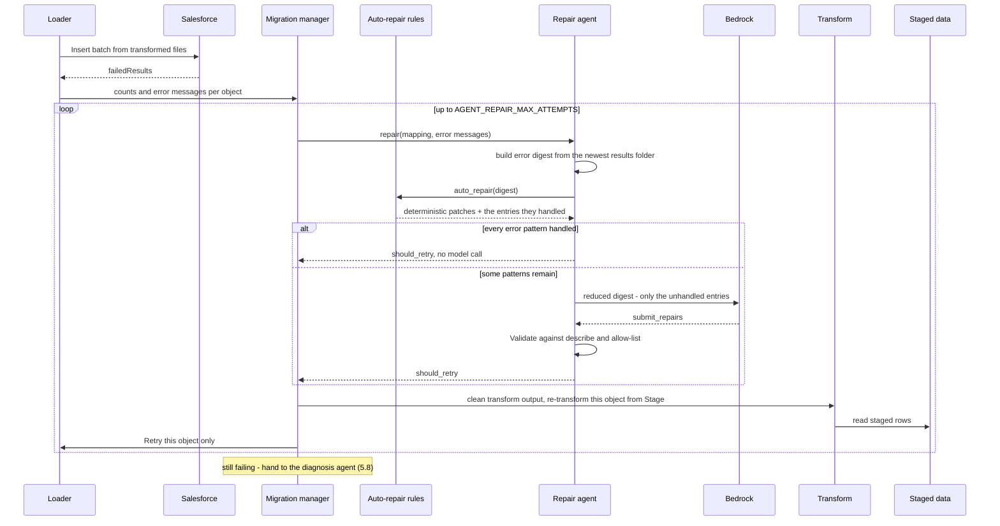

`agents/error_digest.py` aggregates the failed-result CSVs into unique error classes with counts. The repair agent sees error text, schema and at most `AGENT_DIGEST_SAMPLES` short sample values per class (default 2; `0` removes them). The repair uses the same resolution vocabulary and the same validator as the relationship agent. A repair sets `should_retry` only when it actually applied something and the error class is retryable; the retry itself is the pipeline's job. A retry that "fixes" a load error by making the transform discard the row is still counted as failed, so a repair cannot turn a rejection into a silent loss.

#### 5.7.1 Deterministic auto-repair

Some Salesforce errors have exactly one correct fix, and asking a model for it costs time, tokens and reproducibility. `agents/auto_repair.py` runs first inside `repair_agent.repair()` and handles these without a model call:

| Error | Fix it wires |
|-------|--------------|
| `INVALID_CROSS_REFERENCE_KEY` on a lookup fed a raw source id | `generic_lookup` against the id-mapping table the parent mapping (or, for a self-reference, this mapping) writes |
| `FIELD_CUSTOM_VALIDATION_EXCEPTION` naming a *"Min character limit is N and Max character limit is M"* rule | `generic_length_guard` with those limits. If the guard already enforces them and rows still fail, `limit_margin` is tightened by one on each retry, up to 3 |
| `STRING_TOO_LONG` | `generic_length_guard` at the length in the message, or the field's described length |
| `UNKNOWN_EXCEPTION` with *"X must be after/before Y"* | `generic_rules` on the dependent date, clearing it whenever its prerequisite source column is empty |
| `REQUIRED_FIELD_MISSING`, or a validation message such as *"Please enter a Cancelled Reason"* | If the field is unmapped: map it from the best-matching source column (token overlap with a small synonym table) behind `generic_default_if_empty`, or a constant `Not Specified` when nothing matches. If it is mapped but sometimes empty: wrap it in `generic_default_if_empty` |

Every fix is journalled under agent `auto_repair` with the same run id as the repair pass, so it appears in the session's change log and can be reverted like any other agent write. When every error pattern was handled, the model is not called at all; otherwise the model sees only the entries the rules did not claim. Auto-repair also writes its fixes back into the shared `MigrationContext`, because the repair agent persists whole configs from its own draft and would otherwise erase them.

When the destination cannot be described, auto-repair falls back to the field names in the mapping itself, so an error message can still be matched to the field it names.

### 5.8 Diagnosis agent

Repair stops at what it can fix safely. When an object still has rejected rows after the last attempt, `migration_manager._diagnose_remaining()` calls `agents/diagnosis_agent.py`, emits *"asking the agent to diagnose why"* on the progress stream, and later *"Diagnosis ready for Incident: 2 suggested fix(es)"*. A diagnosis is advice: it never blocks or fails the run, and it writes no mapping.

The agent investigates before concluding, using a tool set shared with the assistant (`agents/tools.build_diagnosis_tools`):

| Tool | What it returns |
|------|-----------------|
| `list_mappings`, `describe_mapping`, `describe_destination_object`, `describe_source_table`, `get_error_digest` | The same schema and configuration tools the repair agent uses |
| `sample_failed_rows` | Up to 10 rows from the newest load's `failed.csv`: the error, the values that were sent, and the staged source row they came from (joined back through the source-id column, or through `id_mappings` from the Salesforce id) |
| `profile_source_field` | For one staged column: row count, empty count, distinct count and the ten most common values, reading at most 200,000 rows |

The two data tools are the only place an agent sees record values. Every value is truncated to 60 characters. Only the mapped source columns of a row are returned, and empty values are kept on purpose, because an empty prerequisite is often the whole explanation. With `AGENT_DIGEST_SAMPLES=0` both tools still return counts and error text, but no values.

It submits once through `submit_diagnosis`: an `analysis` in plain language, the `evidence` it actually saw, and two or three ranked `suggestions`, each with a trade-off. A suggestion that a mapping change implements carries `resolutions`, and each one is run through `resolutions.validate()` before it is stored. Rejected ones are kept beside it with the reason. A suggestion that needs a person — change a validation rule, fix the source data — has none.

The result is stored in `agent_diagnoses`. When the model cannot be reached, a deterministic summary of the error digest is stored instead, so the session still says what failed and the assistant can pick it up later. `POST /api/mapping-agent/diagnoses` runs a diagnosis on demand for any object in the session.

### 5.9 Assistant agent and proposals

`agents/assistant_agent.py` is a per-session conversation. A person asks why records failed, or tells the agent what to change, and the agent investigates with the diagnosis tools plus `get_diagnosis`. It runs the same bounded tool loop without a submit tool: the turn ends when the model answers in text. The last 20 messages are replayed as history, and consecutive same-role turns are merged so the transport's alternation rule holds. Credentials come from the session's linked saved connection when there is one.

It cannot write. When a mapping change is needed it calls `propose_changes` (or `propose_rerun` when only a re-run is needed), and the proposal is built deterministically:

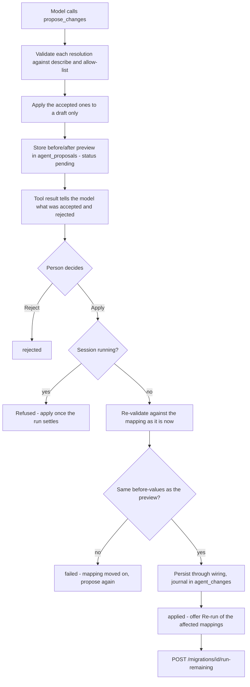

Three properties matter:

- **Apply never calls the model.** What is written is what was stored, re-validated. A proposal whose before-values no longer match the current mapping is refused rather than applied over someone else's edit.
- **A diagnosis suggestion becomes a proposal in one click.** `POST /diagnoses/{id}/propose?suggestion=n` turns one of its suggestions into a pending proposal without a model call, and refuses one whose resolutions were all rejected, so a "fix" that changes nothing cannot be offered as one.
- **Everything applied is revertible.** Applied proposals are journalled under agent `assistant` with the proposal's own `run_id`, so the usual per-item revert works.

Proposals record their `origin` (`diagnosis` or `chat`) and the `diagnosis_id` they came from. `agent_messages` holds the conversation and links an assistant message to the proposal it produced.

### 5.10 Resolution history

`GET /api/mapping-agent/resolutions` returns every mapping change an agent applied in the session, grouped by run and agent, newest first. Auto-repair and the repair agent share a run id when they act on the same failure, so a group is identified by run *and* agent. A change written by applying a proposal is recognised by the proposal's `run_id` and shown with its summary, its origin and the diagnosis it came from. Notices are left out because they change nothing. `ResolutionsPanel` renders this from the run view's **Resolutions** button, with a per-item revert.

### 5.11 Advisory model uses

Two places call a model without ever writing configuration:

- **Field matching** (`POST /api/mappings/semantic-suggest`) pairs the fields a draft has not mapped yet, covering both the obvious name agreements and the pairs only a reading of the labels would find. Every proposal is schema-checked, confidence-filtered against `AGENT_FIELD_MATCH_MIN_CONFIDENCE`, and then accepted by a person in the mapping step. Candidate lists are capped at `AGENT_FIELD_MATCH_MAX_FIELDS` per side; a wide table therefore takes more than one pass, which the report flags.

  The confidence shown in the field mapper's **Conf** column is the model's judgement of *semantic* similarity: how certain it is that every value in the source field would be a correct value for the destination field. It is judged from label, type, referenced object, picklist values and table, and explicitly not from name resemblance. Identical names earn no credit on their own, so `u_caller_id` → `ContactId` can score as high as `priority` → `Priority`. The bands are 0.9–1.0 for exactly the same fact, 0.7–0.9 for the same fact at a different grain or format, 0.5–0.7 for overlapping meanings where some values would not carry over, and below 0.5 for a guess. It is a model judgement rather than an embedding distance, because embeddings of field names and labels reintroduce the name bias, and their raw values are not calibrated against these thresholds.
- **Order advice** (`POST /api/mapping-agent/suggest-order`) narrates a migration order over the hierarchy graph. The response is validated against the deterministic graph — unknown objects dropped, parent-before-child conflicts flagged, omissions appended — and carries both the model's sequence and `computed_order` alongside a `matches_computed` flag.   The loader continues to use the computed order.

### 5.12 Data readiness

Before a migration runs, the review step (wizard step 5) can check whether the source can actually fill what Salesforce requires. `POST /api/mapping-agent/readiness` runs the check for the selected mappings, `DataReadinessPanel` shows the result, and a person decides what to apply. Nothing is written by the check itself.

**Deterministic classification.** `agents/readiness.analyse()` walks every required, createable field of each selected destination object. It then follows required lookups to the objects they point at, through the mappings that load those objects, so the chain `Incident → User → …` is checked as well. Each requirement gets exactly one status:

| Status | Meaning |
|--------|---------|
| `covered` | Mapped to a source column that is filled on every row, a constant, or a column wrapped in a fallback transform |
| `partial` | Mapped, but `n` source rows are empty and no fallback is in place |
| `unmapped_with_candidate` | Not mapped, but a source column looks like the right one (weighted token overlap: a direct name match outranks a synonym match) |
| `no_source` | Not mapped and nothing similar exists, or the mapped column is not on the source table |
| `parent_migratable` | A required lookup whose parent object a mapping loads, either one in the run or one that could be added to it |
| `parent_creatable` | A required lookup whose parent nothing migrates, but the API can create a record for it |
| `parent_not_creatable` | A required lookup whose parent cannot be created through the API (`BusinessHours`, `Profile`, …) |
| `capacity` | A User mapping would need more licences than the org has left |

The status of a gap decides what the agent may change in Salesforce. There are four cases:

1. **The parent can be created and a mapping migrates it** (User from `sys_user`, Account from `core_company`). Nothing is written to Salesforce. The suggestion adds that mapping to the run and wires the lookup with `lookup_reference`.
2. **The parent can be created but nothing migrates it** (a default Queue or Group, a placeholder Account). An existing record is preferred and pinned with `constant_reference`. Only if none fits does the suggestion `create_record` one, pointed at through `{{action:0}}`.
3. **The source has data but Salesforce has no field for it.** The suggestion is `create_custom_field`, then a mapping onto the new field.
4. **The parent cannot be created through the API** (UserLicense, Profile, PermissionSetLicense, Organization, BusinessHours). The agent never tries to create it. It queries the existing records and maps onto them with `constant_reference` or `record_value_map`. For User it also checks free licence seats against the source user count. When capacity is short or no record fits, it returns manual steps: migrate only active users, load people as Contacts, assign records to one integration user, or have an administrator add licences.

Picklist values and validation rules are always manual steps, because both are metadata deployments that are hard to revert.

Source empties are counted on the source itself, not on staged data, and the counts are cached per check. A source column name is matched with or without its table prefix, so `short_description`, `incident.short_description` and the inherited `task.short_description` all count as the same column. For a comma-separated multi-column source, every column must exist.

**Agent pass.** `agents/readiness_agent.py` gives the model the report, through `get_readiness_report`, plus `count_source_empty`, `query_destination_records` and the usual describe tools. It submits once through `submit_readiness`, with one or more suggestions per gap. The loop is bounded like the other agents, and on the penultimate turn the model is told to submit with what it has. A gap with no usable model suggestion gets the rule-based ones (`deterministic_suggestions`), and when the model cannot be reached the whole report is built from rules. Each gap records whether its suggestions came from `agent` or `rules`.

A suggestion can combine five things:

- `resolutions`: mapping changes in the existing vocabulary (§5.6), plus `record_value_map` (map source values onto existing Salesforce record ids).
- `include_mappings`: mappings to add to the run, for a parent another mapping loads.
- `salesforce_actions`: changes made in Salesforce.
- `source_actions`: changes made to the data in the source system.
- `manual_steps`: work for a person, used when the change is beyond what the API or the agent may do.

The agent decides which system a fix belongs in. It changes the mapping when only Salesforce needs the value, for example a default Subject. It changes Salesforce when the org lacks a parent record or a field. It changes the source when the source record is itself incomplete and one value is right for every empty row. Where two of these are reasonable it offers both, ranked. The rule-based suggestions do the same for the cases that need no judgement. A partly empty text field gets a mapping default and, as a second option, a source fill with the same value. A required text field with a candidate column is mapped from that column, with a default. A lookup onto a parent that nothing migrates is pinned to an existing record. All of these come with an Apply button.

**Source action vocabulary.** `agents/source_actions.py` accepts one kind, `fill_source_values`: set one column to one value on the records of a source table where that column is empty, optionally narrowed by an encoded-query `filter`. Validation, against the live source, requires the following:

- The table must be one a mapping in the check reads.
- The column must exist and must not be a `sys_` column.
- A reference column's value must be the sys_id of an existing record. The agent finds one with `query_source_records`.
- The filter must not contain an OR block (`^NQ`, or a leading `OR`) that would widen the selection.
- The number of matching empty records must be between 1 and `READINESS_SOURCE_MAX_ROWS` (default 2000). Beyond that the fix belongs in the mapping.

On apply, the matching record ids are read first and journalled in `agent_source_changes` (`013_agent_source_changes.sql`). Each record is then patched with `sysparm_suppress_auto_sys_field=true`, so `sys_updated_on` and `sys_updated_by`, which the migration carries over, stay as they were. Business rules on the table still run. Writing to the source is a provider capability (`find_record_ids`, `update_record` and `query_records` on the source plugin), and only ServiceNow implements it.

**Salesforce action vocabulary.** `agents/sf_actions.py` accepts two kinds of action, and validates each against a fresh describe before it is stored:

- `create_record` must supply every required createable field. A restricted picklist value must be allowed, and a lookup value must be a record id or `{{action:N}}`, meaning the record created by an earlier action in the same suggestion. A forward reference is rejected. Objects the API cannot create are refused, and so are objects that are createable but not the agent's decision: `User` (licence seats), permission sets and their assignments, `UserRole` and `Profile`.
- `create_custom_field` needs an `__c` API name that is not on the object yet, and one of the plain types: Text, Number, TextArea, LongTextArea, Checkbox, Date, DateTime, Url, Email or Phone.

When one action is rejected, every action after it in the suggestion is rejected too, because later steps usually depend on earlier ones. Resolutions may also use `{{action:N}}` as a constant or a value-map target, and it is replaced with the created id at apply time.

**Transform parameters.** Every `type_coercion` and `value_map` resolution, whichever agent proposes it, is checked against `resolutions.TRANSFORM_PARAMS`. A parameter the transform does not read (`fallback_fields`, or `length` for `max_length`) is rejected with the list of accepted ones, instead of being saved and silently ignored. Extra source columns go in `source_field`, comma-separated. Columns are rewritten against the mapping's driving table unless they name one of its joined tables.

**Approve, then apply.** `POST /readiness/{id}/apply?gap=&suggestion=` applies one stored suggestion. The panel shows a preview first: mappings to add, source steps with the number of records each changes, Salesforce steps, and each mapping field before and after. A suggestion that writes to either system needs a second, explicit confirmation. Apply never calls the model:

1. Re-validate the stored source actions, Salesforce actions and resolutions against the current source, describe and mapping.
2. Run the source actions. If a write fails, the records already written are emptied again.
3. Run the Salesforce actions in order, substituting created ids. If one fails, the records already created by this apply are deleted again, the source writes are undone, and nothing is written to the mapping.
4. Replace the placeholders in the resolutions with the created ids, then persist them through `wiring`, journalled in `agent_changes` under agent `readiness` with a fresh run id. If this fails, both earlier steps are rolled back.
5. Store the outcome on the check. A suggestion that is already applied and not reverted is refused.

The panel then reloads the affected mappings in the wizard, and adds any included mappings as new cards.

**Journal and revert.** Salesforce writes are journalled in `agent_sf_changes` (object, record or field, the values sent, run id). Reverting the mapping change uses the normal `POST /runs/{run_id}/revert`. `POST /readiness/sf-changes/{id}/revert` deletes a created record. `POST /readiness/source-changes/{id}/revert` empties the column again on the journalled records, but only where it still holds the value written. A record someone has edited since is kept, and the response counts it. A created custom field is not deleted, because deleting a field in Salesforce is not reliably reversible and discards its data. The panel says so, and the field is left to an administrator. Once every change belonging to an applied suggestion is reverted, the check shows the suggestion as reverted and it can be applied again.

Each check is stored in `agent_readiness` (`012_agent_readiness.sql`) with its report, suggestions and apply outcomes, and `GET /readiness/{id}` returns it. Apply works from this stored copy, never from what the browser holds. The deterministic parts — classification, source-column matching, parameter checks, action validation, placeholders and rollback — are covered by `tests/test_readiness.py`, which mocks every describe and count.

---

## 6. Deferred references and backfill

This is the mechanism behind "split into two passes", and it is the part of the design that changed most during implementation.

### 6.1 The problem

Some references cannot be ordered away. A record pointing at its own object, or two objects pointing at each other, has no parent-first sequence. The remedy is to insert without the reference and fill it once both sides have Salesforce ids.

The original design only recognised this when **both** sides of the cycle were in the same run. In practice an operator selects `Account` alone, `Account` and `User` reference each other, and nothing engaged: no deferral, no backfill unit, no notice. That is what the `deferrable_cycle` finding fixes. It fires when a mapped reference field has no *selected* mapping covering its targets, but a mapping for one of those targets exists in the catalog and that object references back. The lookup is then wired as a `deferred_lookup` carrying `defer_parents` — the names of the mappings it is waiting on — so the UI can say *"Add `User` to this migration and run it"* rather than the useless *"migrate the object it points at first."*

### 6.2 Lifecycle

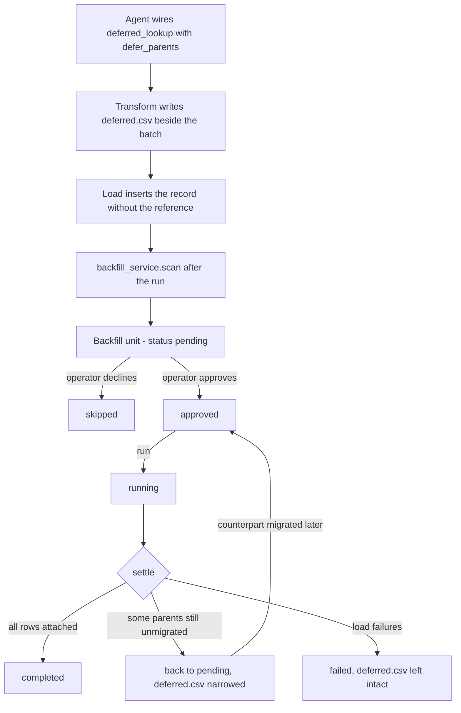

A unit is one `(session_id, mapping_name, field)` row in `backfill_units`. `rows_deferred` is how many rows are waiting; `rows_resolvable` is recomputed from the current `id_mappings` so the UI can show whether running it now would achieve anything. `awaiting_object` records what the wait is on, which section 6.5 explains.

### 6.3 Approval and execution

Approval and execution are deliberately separate calls. `POST /api/migrations/backfill/{id}/decision` records approve or skip and does not run anything; `POST /api/migrations/backfill/{id}/run` executes an approved unit. Nothing writes to Salesforce without the operator asking for it explicitly.

Execution clones the mapping as an `update` operation over the single deferred field, pointed at the original id map, filtered to the deferred record ids, and runs it through the normal transform and load path. `settle()` then decides the outcome. The important case is the partial one: if some referenced parents are still not in the id map, the unit returns to `pending` and `deferred.csv` is rewritten to keep only the rows that are still unattached, with `records_updated` accumulating across passes. An earlier version marked partial fills `completed` and silently dropped the remainder.

The dashboard carries a cross-session reminder for units that have become runnable, so a deferral raised in one session is not forgotten once its counterpart migrates in another.

### 6.4 Hand-authored lookups

Everything above describes lookups the agent wires. A lookup created by hand in the field mapper reaches the same `generic_lookup` transform but had none of the same guarantees, and the gap was severe enough to lose a whole object's worth of records.

A lookup does not point at an object; it reads an `id_mappings` table, and that table's name is built from the *parent* mapping's driving table, destination object and transformation name. A child mapping knows none of those, so the editor cannot derive the name — it used to write the destination object's own name instead. No table of that name is ever created, so the lookup returned empty for every row of every batch, and with skipping enabled that discarded the entire object while reporting no failures. `GET /api/mappings/lookup-resolution` closes this: it answers with the table names the catalog's mappings will actually write, computed by the same `wiring.lookup_table_name()` the agent uses, together with how many ids each already holds.

That answer also decides how unresolved rows behave, which is the difference between a reference that can be recovered and one that is gone:

| Configuration | The record | The reference | Recoverable later |
|---|---|---|---|
| `skip_if_not_found: true` | discarded | — | only by re-running; the row is listed in the batch's `_errors.csv` |
| neither flag | loads | left empty, **not recorded** | no — nothing remembers what it pointed at |
| `defer_to_backfill: true` | loads | left empty, recorded in `deferred.csv` | yes, by the backfill pass |

Deferral is therefore the default for every hand-authored lookup: rows that resolve are unaffected, since only an empty result is recorded, so the flag costs nothing where it is not needed and preserves the link where it is. The checkbox remains available so it can be turned off deliberately.

### 6.5 Waiting on an object that has not been migrated

The two reasons above — a cycle and a self-reference — are both properties of the *ordering* within a run. A third case is not: the object being pointed at is simply not migrated yet, and will be later. This was initially treated as un-deferrable, on the reasoning that a deferral nothing can honour sits in the queue forever. That reasoning was wrong in the case that matters most, which is `Incident.ResolvedById` waiting on `User`: those references are exactly the ones worth keeping, because building that mapping is the normal way such a wait ends. Refusing to defer them discarded the link permanently in order to avoid an untidy queue.

Supporting it needed three changes, because none of the existing machinery fit:

**`REASON_PARENT_PENDING` exists so the explanation can be true.** `_describe()` previously chose between two sentences, both asserting a loop. Telling an operator that two objects reference each other when they have simply not migrated one of them sends them looking for a cycle that is not there. The new reason also splits present from past tense: *"`User` has not been migrated yet, so there is nothing to point at"* while it is stuck, and *"they were loaded before `User` was migrated"* once the fill is available — one sentence used for both ends up claiming an object is missing on the very line offering to attach the ids it provided.

**The wait is recorded as an object, not a table name.** A deferral's `lookup_tables` is resolved when the deferral is written, but an object with no mapping has no table name to write: the name is derived from the *future* mapping's driving table, destination object and transformation name. Guessing produced a name that was then watched forever without ever appearing. The field therefore carries `defer_object`, the unit carries `awaiting_object`, and `_resolve_tables()` asks `mappings_service.lookup_targets_for_object()` at every check. This is what lets the wait end on its own — build any mapping that loads the object, under any name, and the next check finds it.

**The end of the wait is announced.** `scan()` only covers the mappings in the run that just finished, so migrating the awaited object refreshed nothing belonging to the run that was waiting for it. `newly_fillable()` re-checks every pending unit across all sessions and reports only those whose resolvable count *increased*, so the completion message says what this run unblocked elsewhere, the event carries them in `unblocked_backfill`, and `BackfillPanel` lists them alongside the session's own. Without this the counts did change, but only on a page nobody had a reason to revisit.

So a reference is now spoken about at both ends: before the run that leaves it empty, and after the run that makes it fillable.

The `unresolvable_lookup` finding is correspondingly narrowed. A deferred field whose target nothing migrates is still reported — records accumulating against an object nobody has built a mapping for is worth knowing — but as a warning that the link is *kept*, advising that a mapping be built. It previously advised pinning the field to a fixed record or unmapping it, which is advice to abandon the arrangement that preserves the data.

### 6.6 Column fill — writes nobody owed

A backfill is *owed*: the loader could not resolve a lookup and has to come back. Sometimes a column needs a value for a different reason. A destination field turns out to be required, or the value it got was wrong, and the records are already loaded. Re-running the whole object to change one column is heavy, and for an insert-based mapping not even safe. `services/internal/column_fill_service.py` writes a single column on the records a session already loaded, and decides the value in one of three modes:

| Mode | Value |
|------|-------|
| `constant` | The same value on every record |
| `value_map` | Mapped from one source column — the shape the picklist value matcher produces |
| `rules` | Ordered conditions over the source row; the first match wins (`generic_rules`) |

Rows no rule or map claims are skipped, blanked, or given a fixed value, as the spec says (`unmatched`).

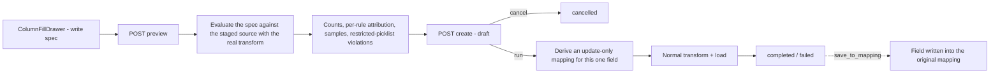

There is no approval gate, because nothing is owed. The **preview** is the check instead. It runs the very transform the update will run, so what it reports is what will happen. It keeps apart three counts that are easy to conflate: rows in the staged extract, rows that actually have a destination record to update, and rows a value was produced for. It also checks produced values against a restricted picklist before anything is sent. A job is created as a `draft` and only leaves that state when it is run, so an abandoned drawer leaves a readable record of what was being considered rather than a half-applied change.

The write path is nothing new. `build_config()` derives an `operation: "update"` copy of the mapping that holds only this field and points `look_up_table_names` at the original id map, since that is where each record's destination id lives. It writes under its own `transformation_name` (`…__fill__{field}`) so its CSVs never mix with the original pass's. It drops `external_id_field`, because an upsert here could create records, and it sets `skip_if_not_found` so a row the fill does not cover is left untouched. With `save_to_mapping` the field is also written into the original mapping, *without* `skip_if_not_found` — on an insert that flag would discard the whole record — so later runs of the object repeat the fill.

Each fill is one row in `column_fill_jobs`, with the spec kept verbatim so a past fill can be read back and repeated long after the run that produced it. `ColumnFillPanel` in the run view lists them.

---

## 7. Session persistence and resume

### 7.1 What a checkpoint is

A checkpoint is the record of **what has already been written to the destination**, so a session interrupted part-way through continues instead of restarting.

| Stored in the checkpoint | Not stored |
|--------------------------|------------|
| `id_mappings` rows for this session's tables | Credentials — redacted before upload |
| The `migration_sessions` row: status, phase, selection, redacted config | The staged extract itself under `data/downloads` |
| The `mapping_configs` as actually run, including agent rewiring | Attachment binaries |
| The `agent_changes` journal for the session | Diagnoses, the assistant conversation and proposals (`agent_diagnoses`, `agent_messages`, `agent_proposals`), and `column_fill_jobs` — local to the app host |
| Job, table, batch and sub-batch progress rows | |
| Run metadata: order, completed objects, counters, per-object records, load errors | |
| A **fingerprint** of the stage: row, byte and file counts per table | |

The stage is excluded because it is large and reproducible from the source. The fingerprint is what lets a resume decide whether the local copy still matches what the checkpoint was taken against, and re-extract only when it does not.

### 7.2 Layout and timing

```text
s3://{MIGRATION_S3_BUCKET}/{MIGRATION_S3_PREFIX}/sessions/{session_id}/checkpoint.json
s3://{MIGRATION_S3_BUCKET}/{MIGRATION_S3_PREFIX}/sessions/{session_id}/id_mappings.jsonl.gz
```

The id map is written first, then the checkpoint document that references it, so a checkpoint is never advertised before the state it points at exists. A local index in `session_checkpoints` mirrors the pointer for fast listing. Checkpoints are taken after extraction, after each clean transform-and-load group, on pause, on stop, on failure, at completion, and on demand. Every save goes through `save_quietly` — a checkpoint failure logs and never aborts a migration.

### 7.3 Resume

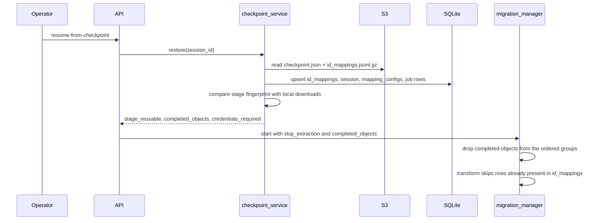

Restoring never overwrites local credentials for a session that already exists, and a restore onto a machine that has never held them reports `credentials_required` rather than pretending it can run. `GET /api/migrations/checkpoints/health` round-trips a write, read and delete against the bucket so the configuration can be verified before a migration depends on it.

---

## 8. Incremental runs

A session's object selection is append-only. `POST /api/migrations/{id}/objects` adds mappings to an existing session without starting anything; `GET /api/migrations/{id}/run-plan` shows which objects a run would execute versus skip; `POST /api/migrations/{id}/run-remaining` runs only what still needs migrating. Removal is not supported — it would orphan destination records and narrow the scope of the id map that later objects resolve against.

This is what makes the deferred-reference story work across sessions: migrate `Account` today, add `User` next week to the same session, and the `Account` backfill unit becomes resolvable and reports itself as ready. It is also how an applied assistant proposal is re-run: the panel calls `run-remaining` with the proposal's `rerun` list, and rows that already loaded are skipped by the transform because they are in `id_mappings`.

### Progress denominators

The per-object status report (`session_status_service`) needs a "rows at the source" figure to measure progress against. A run with a record limit stages only a slice of the table, so the staged extract is no longer the first choice. Each ServiceNow extraction records the source's own row count for the date window on `job_tables.source_total` (other source types do not record it yet, and use the fallbacks). The report prefers that figure (`source_rows_origin: "source"`), then falls back to the staged row count, then to the checkpoint. When the source total is known, an object counts as completed only when everything the source reported has loaded, not merely when the run finished its slice.

### Session-scoped connections

Choosing an object mid-session is the same decision as choosing one in the wizard, so it is given the same things to decide with: the Salesforce dependency hierarchy, the advisory order, and a describe drawer over any object in the graph. Reaching any of that needs credentials, and a session's credentials are masked by `session_db._row_to_dict` before the API returns them — deliberately, but it left the browser holding `client_secret: "***"` and every describe call failing.

A session therefore records `source_connection_id` and `destination_connection_id` alongside its credentials. An id is a handle the server resolves against `saved_connections`, so unlike a secret it survives the round trip, and every schema, mapping and agent endpoint already accepts `connection_id` in place of an inline dict. Nothing else had to change for the wizard's tooling to work from a loaded session.

| Endpoint | Purpose |
|---|---|
| `GET /api/migrations/{id}/connections` | The linked connections, plus every candidate of the right type flagged with whether it reaches the instance the session was created against |
| `POST /api/migrations/{id}/connections` | Link connections and adopt their credentials |

Sessions created before the ids were recorded, and sessions restored from a checkpoint, have nothing to resolve. The candidate flag is computed by comparing the session's stored credentials against each connection's on their non-secret fields, so the obvious answer can be offered rather than asked for — secrets are excluded because the stored copy may be masked or rotated without changing which instance is meant. Linking rewrites the credentials as well as the id, because a session pointing at one connection while running as another is worse than either; that also repairs a restored session whose secrets came back as placeholders.

The mapping editor is reached from a session with `?source=…&srcConn=…&destConn=…&session=…`, which pre-selects the connections and turns the page into part of the session: it returns there on save, and a mapping created along the way is appended to the selection rather than left to be found and added by hand. Having the connections, the editor lists both sides as searchable pickers rather than free text — an API name typed from memory otherwise fails at load time against real records — and draws the same hierarchy over this mapping's object together with the ones the session already covers.

---

## 9. End-to-end runtime sequence

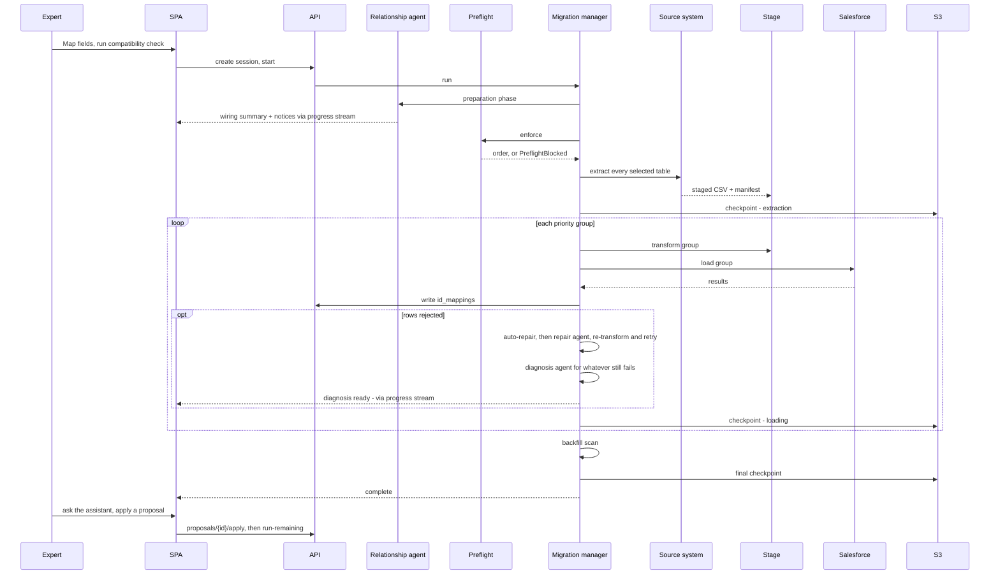

---

## 10. Data model

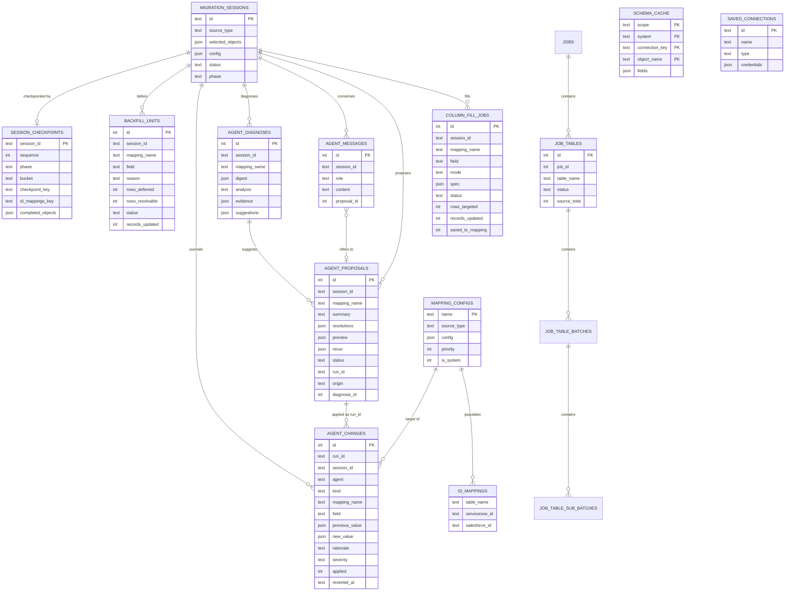

Schema files, in order: `001_id_mapping`, `002_tables_for_jobs`, `003_migration_sessions`, `004_saved_connections`, `005_mapping_configs`, `006_agent_changes`, `007_schema_cache`, `008_session_checkpoints`, `009_backfill_units`, `010_column_fill_jobs`, `011_agent_assistant` (diagnoses, messages, proposals).

Proposal status moves `pending` → `applied` | `rejected` | `failed`. A proposal is `failed` when it no longer validates or its before-values no longer match the mapping at Apply time. Column-fill status moves `draft` → `running` → `completed` | `failed`, or `draft` → `cancelled`.

**Id remap at load time, deterministic:**

```text
Load parent object -> insert rows -> for each success:
  id_mappings[(parent_table, source_sys_id)] = new_salesforce_id

Transform child object reference field:
  generic_lookup(source_sys_id) -> salesforce_id from id_mappings[parent_table]

If the lookup resolves empty and the field is deferred:
  write the row to deferred.csv and load the record without the reference
```

---

## 11. Deployment and trust boundaries

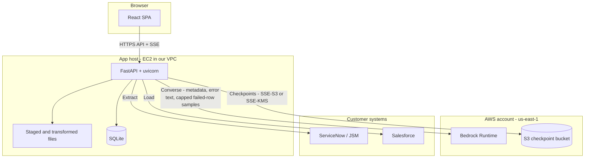

**Security posture**

- Credentials are never sent to Bedrock. They are resolved server-side and captured by tool executors, never declared in a tool input schema, so the model can neither see nor supply them.
- Bedrock receives schema metadata, mapping drafts, dependency graphs and error digests — never extract dumps. The only record values it sees are bounded samples: up to `AGENT_DIGEST_SAMPLES` values per error class in a digest, and, for the diagnosis and assistant agents only, up to 10 rejected rows restricted to their mapped columns and the ten most common values of one staged column. Every value is truncated to 60 characters. Set `AGENT_DIGEST_SAMPLES=0` for a client whose data may not leave the host; the agents then reason from counts, error text and schema.
- Agents have no Salesforce write tools. The only write paths to Salesforce are the existing loader and the backfill and column-fill passes built on it.
- The assistant cannot change a mapping on its own. Its only write-shaped tools store a pending proposal; applying one is a separate, human-initiated API call, refused while the session is running.
- Checkpoints are redacted before upload: `password`, `client_secret`, `secret`, `access_token`, `refresh_token`, `api_key`, `api_token`, `private_key` and `security_token` are stripped.
- Checkpoints are encrypted with the bucket's default SSE-S3, or SSE-KMS when `MIGRATION_S3_KMS_KEY_ID` is set. Keep the bucket in the same region as the instance: cross-region checkpoint writes add latency at every phase boundary.
- Staged data stays on our side under job isolation and never leaves the app host.

---

## 12. Technology map

| Layer | Technology |
|-------|------------|
| UI | React + TypeScript (Vite), SSE for live progress |
| API | FastAPI + uvicorn |
| Agents | Amazon Bedrock Converse with tool use (Claude), or the Anthropic SDK against a Bedrock endpoint |
| Extract / transform / load | Existing controllers driven by `migration_manager` |
| Stage | Local filesystem under `data/` |
| Metadata | SQLite (`mapping_configs`, `id_mappings`, jobs, sessions, `agent_changes`, `agent_diagnoses`, `agent_messages`, `agent_proposals`, `backfill_units`, `column_fill_jobs`, `schema_cache`) |
| Durability | S3 session checkpoints |
| Ordering and compatibility | `compat_engine`, `hierarchy_service`, `prerequisites_service` |

Both agent transports reach the same models and are normalised behind one client, so the agent loops never branch on transport. `boto3` uses the instance role; `anthropic` uses an API key. The transport is chosen by `BEDROCK_PROVIDER`, or inferred from the presence of `ANTHROPIC_API_KEY`.

---

## 13. API surface

All routers are mounted under `/api`.

### Agent — `/api/mapping-agent`

| Endpoint | Role |
|----------|------|
| `GET /status` | Agent configuration; `?probe=true` round-trips the model |
| `POST /analyze-relationships` | Resolve edge cases and wire them in |
| `POST /plan` | The same analysis with the write suppressed |
| `POST /suggest-order` | Advisory migration order over the hierarchy graph |
| `POST /preflight` | Run the launch gate without starting a migration |
| `POST /repair` | Auto-repair, then the repair agent, for one mapping's load failures |
| `GET /changes` | Journalled changes and notices, filterable by run, session or mapping; `scope=latest` limits to the current attempt |
| `DELETE /changes/notices?session_id=` | Drop the session's notices from earlier attempts |
| `POST /changes/{id}/revert` | Revert one change |
| `POST /runs/{run_id}/revert` | Revert a whole agent run |
| `GET /diagnoses?session_id=&scope=latest` | Newest diagnosis per failing object |
| `POST /diagnoses` | Diagnose one object's current failures on demand |
| `POST /diagnoses/{id}/propose?suggestion=n` | Turn one suggestion into a pending proposal; no model call |
| `GET`/`POST`/`DELETE /chat` | Conversation history with proposals and diagnoses; one assistant turn; clear the conversation |
| `POST /proposals/{id}/apply`, `/reject` | Apply (re-validated, journalled, revertible) or reject a proposal |
| `GET /resolutions?session_id=` | Every applied agent change in the session, grouped by run and origin |

### Migrations — `/api/migrations`

| Endpoint | Role |
|----------|------|
| `POST /`, `GET /`, `GET /{id}` | Session create, list, detail with live progress |
| `POST /{id}/start` \| `/pause` \| `/resume` \| `/stop` \| `/retry` | Lifecycle control |
| `GET /{id}/progress` | **SSE** stream of `ProgressEvent`, keepalive every 20s |
| `GET /{id}/status` | Per-object status report, works for finished sessions too |
| `POST /{id}/objects` | Append objects to the selection |
| `GET /{id}/run-plan`, `POST /{id}/run-remaining` | Incremental runs |
| `GET`/`POST /{id}/connections` | The saved connections the session resolves through, and linking one |
| `GET /checkpoints/status`, `/checkpoints/health`, `/checkpoints` | Checkpoint configuration, bucket probe, listing |
| `GET`/`POST`/`DELETE /{id}/checkpoint` | Read, force-save, delete a checkpoint |
| `POST /{id}/restore`, `POST /{id}/resume-from-checkpoint` | Rehydrate, and rehydrate then continue |
| `GET /backfill` | Deferred reference units |
| `POST /backfill/{id}/decision`, `POST /backfill/{id}/run` | Approve or skip; execute |
| `POST /{id}/backfill/run-approved` | Execute every approved unit for a session |
| `GET /{id}/column-fill/targets` | Mappings in the session whose loaded records can be filled |
| `POST /{id}/column-fill/preview` | Evaluate a fill spec against the staged source; writes nothing |
| `POST /{id}/column-fill` | Record a fill as a draft |
| `POST /column-fill/{job_id}/run`, `/cancel`; `GET /column-fill` | Execute or cancel a draft; list fills |

### Mapping and schema

| Endpoint | Role |
|----------|------|
| `/api/mappings/` CRUD, `/{name}/validate` | Mapping configs |
| `POST /api/mappings/semantic-suggest` | Model-assisted field pairing, proposals only |
| `GET /api/mappings/lookup-resolution` | Which id-mapping table a lookup to an object should read, and whether anything can fill it |
| `POST /api/schema/source-tables`, `/source-fields`, `/source-values` | Source metadata |
| `POST /api/schema/destination-objects`, `/destination-fields`, `/destination-records` | Salesforce metadata |
| `POST /api/schema/prerequisites`, `/destination-hierarchy` | Dependency graphs for the tree view |
| `GET /api/transforms/?source_type=` | Transform functions available to that source type |
| `POST /api/compat/check`, `/type-check` | Compatibility report and type coercion advice |
| `/api/connections/` CRUD, `/api/sources/…` | Saved connections and source providers |
| `POST /api/destinations/salesforce/validate-credentials`, `/diagnostics` | Salesforce connection and object visibility |
| `POST /api/custom-fields/suggest`, `/create` | Create a missing Salesforce custom field from the wizard, optionally as an External Id |

---

## 14. Web UI surface

**Wizard**, six steps: select source → destination → select objects → map fields → compatibility → review and run.

Step 3 selects on **both** sides — source tables and Salesforce objects — and renders `DestinationHierarchy`, a tree of the ancestor graph above the selected objects built by `hierarchy_service`. Nodes are tiered required / needed / optional, cycles are marked, and clicking a node opens `ObjectFieldsDrawer` with that object's fields, types and flags. The AI order suggestion is offered here and labelled advisory.

Step 5 runs the compatibility check and the agent preflight, so deferred lookups and blockers are visible before launch and missing custom fields can be created inline.

**Run views**

| Component | What it shows |
|-----------|---------------|
| `MigrationDetail` | Live progress over SSE, phase, per-object counters, controls, activity log |
| `AgentNoticesPanel` | What the agent wired, with per-item revert; notices with their suggested action, for the current attempt |
| `AgentAssistantPanel` | Diagnoses with ranked suggestions, the assistant conversation, pending proposals with before/after, Apply / Reject, and Re-run after applying |
| `ResolutionsPanel` | Drawer from the **Resolutions** button: every applied agent change grouped by run and origin, with revert |
| `BackfillPanel` | Deferred references, resolvable counts, approve / skip / run |
| `ColumnFillPanel` + `ColumnFillDrawer` | Past and draft column fills; the drawer builds a constant, value-map or rules spec and shows the preview before running |
| `SessionObjectsPanel` | Session run plan, add objects, run remaining |
| `SessionStatusPanel` | Per-object status report, polled every 4s while running |
| `Dashboard` | Session list with progress, plus a cross-session reminder for runnable backfills |

---

## 15. Configuration reference

| Variable | Default | Controls |
|----------|---------|----------|
| `BEDROCK_PROVIDER` | inferred | `boto3` or `anthropic` transport |
| `BEDROCK_REGION` | `AWS_REGION`, then `us-east-1` | Bedrock region |
| `BEDROCK_RELATIONSHIP_MODEL_ID` / `_REPAIR_` / `_FIELD_MATCH_` | per-provider defaults | Model per agent role |
| `AGENT_AUTONOMY` | `apply` | `preview` analyses only; `apply` writes mapping configs |
| `AGENT_MAX_TOKENS_PER_CALL` / `_PER_SESSION` | 8000 / 200000 | Spend caps |
| `AGENT_MAX_TOOL_ITERATIONS` | 12 | Turn cap per agent loop |
| `AGENT_TEMPERATURE` | 0.0 | Sampling; dropped automatically for models that set their own |
| `AGENT_PREFLIGHT_ENFORCE` | true | Whether blocking findings stop a launch |
| `AGENT_AUTOWIRE` | true | Run the relationship agent at launch |
| `AGENT_REVIEW_ALWAYS` | true | Invoke the model even when the detector found nothing |
| `AGENT_REPAIR_ENABLED` / `_MAX_ATTEMPTS` | true / 2 | Post-load auto-repair, repair agent and diagnosis. Per run, `agent_repair` overrides it and `agent_diagnosis: false` skips only the diagnosis |
| `AGENT_DIGEST_SAMPLES` | 2 | Sample values per error class in a digest; `0` also hides row values from `sample_failed_rows` and `profile_source_field` |
| `AGENT_FIELD_MATCH` / `_MAX_FIELDS` / `_MIN_CONFIDENCE` | true / 250 / 0.5 | Model-assisted field matching |
| `MIGRATION_S3_BUCKET` / `_PREFIX` / `_REGION` / `_KMS_KEY_ID` / `_ENABLED` | — / `itsm-migration` / `us-east-1` / — / true | Session checkpoints |
| `SEED_SYSTEM_MAPPINGS` | 1 | Seed shipped JSON mappings when `mapping_configs` is empty |

`.env.example` carries the annotated version of this table. Note that `python-dotenv` cannot read a `set ` or `export ` prefix on an assignment; a prefixed line is silently dropped.

---

## 16. Delivery status

| Stage | Status |
|-------|--------|
| Bedrock client, two transports, token accounting | done |
| In-memory draft configs for the resolver and compatibility engine | done |
| Read-only tool adapters | done |
| Agent loop, resolution validator, transform allow-list | done |
| Deterministic detector and the finding vocabulary | done |
| Relationship agent with preview and apply autonomy | done |
| Audit journal and per-item revert | done |
| Preflight gate wired into launch | done |
| Repair agent and error digest | done |
| Deferred lookups and the backfill approval workflow | done |
| Deferrable cycles when only one side is selected | done |
| S3 session checkpoints, restore and resume | done |
| Incremental runs — add objects, run remaining | done |
| Destination hierarchy tree and advisory order | done |
| Model-assisted field matching, replacing the name-similarity pass | done |
| Review-always, notices with suggested actions, wiring summaries in the run view | done |
| Transform functions scoped by source type, enforced at preflight | done |
| Column fill: preview-first single-column updates on loaded records | done |
| Deterministic auto-repair ahead of the repair agent | done |
| Diagnosis agent for failures repair could not fix | done |
| Assistant conversation with human-approved proposals, resolution history | done |
| `remove_field` and applied `deferred_lookup` resolutions; `generic_rules` transform | done |
| Notices and diagnoses scoped to the current attempt | done |
| Source-reported row totals as the progress denominator | done |
| Semantic-similarity confidence for field matching | done |

---

## 17. How to use this document

- Open in Cursor, VS Code or GitHub to render the Mermaid diagrams.
- The narrative version for a non-engineering audience is `docs/architecture.html`. To rebuild its exports:

```bash
node docs/export-diagrams.mjs        # PNGs for the Word build
node docs/generate-architecture-pdf.mjs
python docs/generate-architecture-docx.py
```

- For a slide deck, sections 2, 3, 5, 6, 7 and 11 are the core visual story.
